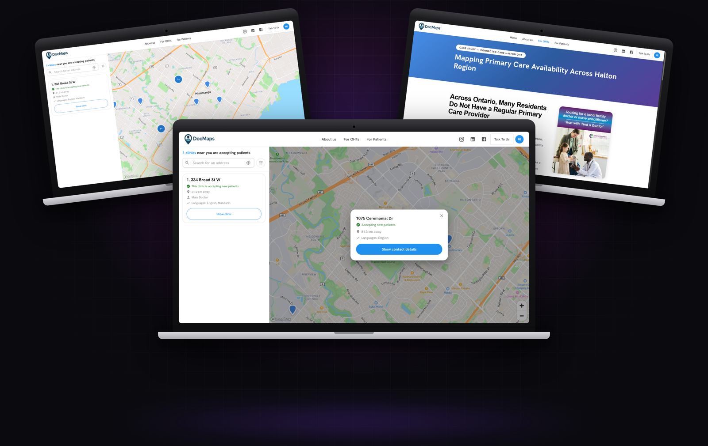
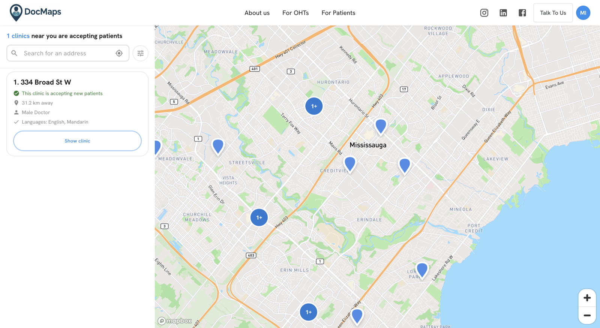
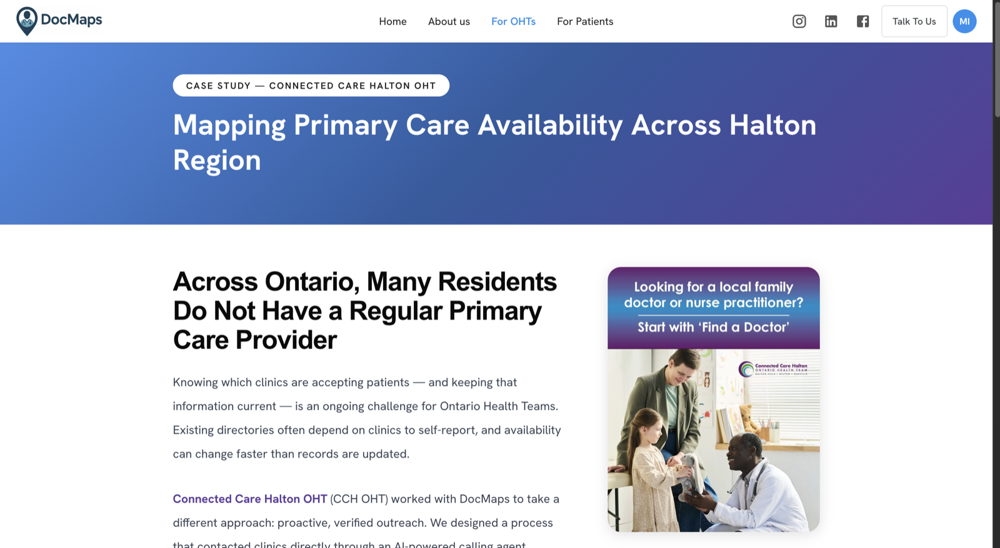
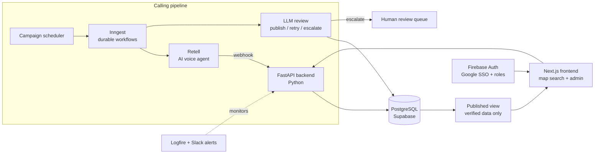

# DocMaps

**A live directory helping patients in Ontario find family doctors who are accepting new patients, kept accurate by AI voice agents.**

> This is a showcase repo. DocMaps is a client product and its source code is private, so this page covers what it does, how it's built and what it looks like. Happy to walk through the architecture on a call.

## The problem

Patients in Ontario struggle to find a family doctor who is actually accepting new patients. Public directories go stale the moment a clinic's intake status changes, so people waste days calling clinics that are full.

## What I built

I'm the lead engineer and built the platform end to end: architecture, backend, frontend, database, the AI calling pipeline, deployment and production support.

- **Outbound AI voice campaigns.** Voice agents call clinics on a schedule and ask whether they're accepting patients, which doctors, languages and more
- **LLM transcript review.** Every call is reviewed by an LLM that extracts structured data and returns a verdict: **publish**, **retry** or **escalate**
- **Human review queue.** Uncertain calls go to reviewers, so nothing unverified reaches patients
- **Durable workflows.** Scheduling, waiting for call results, retries and reviews run as event-driven workflows that survive failures
- **Patient-facing map search** with filters by distance, doctor gender and language, plus public clinic pages
- **Admin portal** for campaigns, reviews, call metrics and agent version comparisons
- **Monitoring and alerting** so failures surface in minutes, not days

## Engineering highlights

- **Webhook race conditions.** The call provider sometimes delivered the same webhook twice, and very fast calls finished before the workflow started listening. I made ingestion idempotent, added event deduplication and replaced a long wait with polling plus a stuck-review recovery job, with integration tests reproducing both races. No calls are lost since.
- **Constrained AI output.** Extracted answers are validated and normalised against allowed values per question, so the LLM can't publish free-form data.
- **Verified-only publishing.** Patients only ever see data from a dedicated published view that's refreshed when a call is verified.

## Screenshots

| Map search | Nearby clinics |
| --- | --- |
|  |  |

## Architecture

## Tech stack

Retell for voice agents, Inngest for durable workflows, SQLAlchemy and Alembic, Mapbox, Logfire for observability, testcontainers for integration tests.

## Contact

**Muhammad Izhar** · [izhar.dev](https://izhar.dev) · [LinkedIn](https://linkedin.com/in/izharrr99) · muhammad.izhar11@gmail.com
